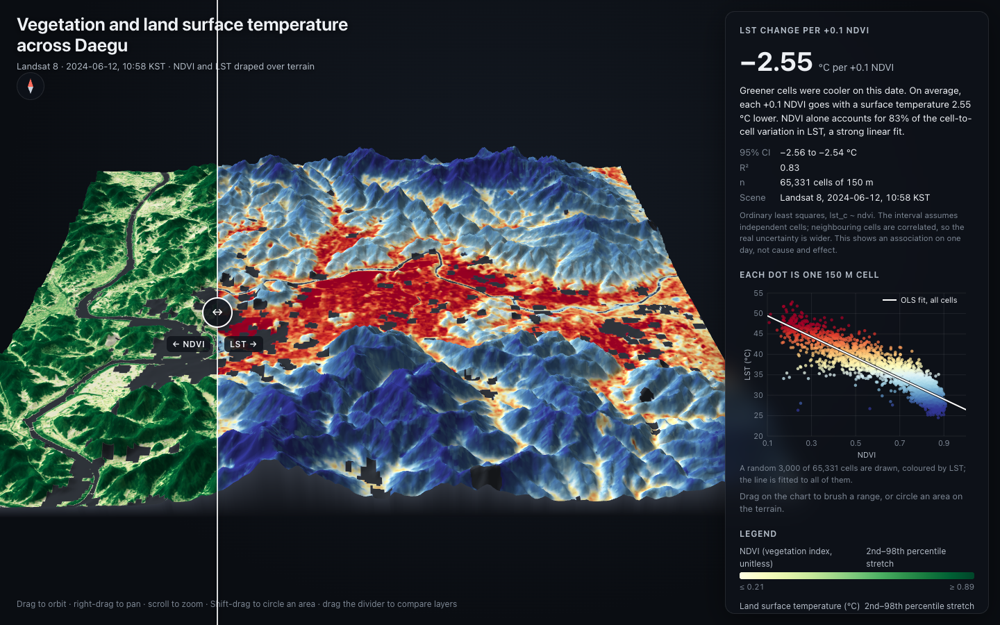

# Vegetation and Land Surface Temperature across Daegu

An interactive 3D map comparing vegetation (NDVI) with land surface temperature
(LST) across Daegu, South Korea, on a clear summer day. Both layers are draped
over terrain, and a swipe divider lets you compare them side by side. Built with Claude Code. 



## Key result

On 12 June 2024 (Landsat 8, 10:58 KST), greener areas were markedly cooler:

| Measure | Value |
| --- | --- |
| LST change per +0.1 NDVI | **−2.55 °C** (95 % CI −2.56 to −2.54) |
| R² | 0.83 |
| Grid cells | 65,331 cells of 150 m |

The fit is ordinary least squares, `lst_c ~ ndvi`. The confidence interval
assumes independent cells; neighbouring cells are spatially correlated, so the
real uncertainty is wider. This is an association on a single day, not
evidence of cause and effect, and it describes surface temperature, not air
temperature.

## Viewing the page

Download [`viz/daegu_summer_heat.html`](viz/daegu_summer_heat.html) and open it
in a browser. Everything (data, textures, three.js) is embedded in that one
file, so it works offline.

- Drag to orbit, right-drag to pan, scroll to zoom
- Drag the divider to compare NDVI and LST
- Drag a rectangle on the scatter plot to highlight those cells on the map
- Shift-drag on the terrain to circle an area
- Press Esc to clear a selection

## How it was made

1. **Scene search** – Landsat 8/9 Collection 2 Level-2 scenes from June to
   September 2022–2026 with under 40 % cloud cover were found through the
   Microsoft Planetary Computer STAC API (54 scenes).
2. **Cloud screening** – The QA band of each scene was read over the study
   area (128.35–128.80° E, 35.70–36.05° N). The clearest scene covering the
   whole area was kept (99.8 % clear).
3. **LST and NDVI** – Thermal band `lwir11` was converted to °C and NDVI was
   computed from `red` and `nir08`. Fill, cloud, cloud shadow, cirrus and
   water pixels were masked.
4. **Web grid** – 30 m pixels were averaged into 150 m cells. A cell needs at
   least two thirds of its pixels valid.
5. **Terrain** – Copernicus DEM GLO-30 was resampled onto the same grid.
6. **Regression** – An OLS line was fitted to all valid cells.

## Repository layout

```
viz/
  build_data.py          fetch imagery, compute LST/NDVI, write viz/data/
  build_page.py          assemble the single-file HTML page from viz/data/
  verify.py              headless browser checks and screenshots
  page_template.html     page layout, styles and three.js code
  daegu_summer_heat.html the finished page
  requirements.txt
  data/                  textures, grids, sampled cells, stats.json
  screenshots/           desktop and phone screenshots from verify.py
  vendor/                three.js r147 and OrbitControls (MIT)
```

## Rebuilding

Requires Python 3.12. Run from the repository root:

```bash
python3 -m venv .venv
.venv/bin/pip install -r viz/requirements.txt
.venv/bin/playwright install chromium   # only needed for verify.py
.venv/bin/python viz/build_data.py      # downloads imagery; add --force to redo every step
.venv/bin/python viz/build_page.py
.venv/bin/python viz/verify.py
```

No API key is needed; Planetary Computer signs data URLs anonymously.
`build_data.py` caches intermediate results in `viz/data/cache/`, which is not
included in this repository.

## Data sources

- Landsat 8/9 Collection 2 Level-2 imagery courtesy of the U.S. Geological
  Survey, accessed through [Microsoft Planetary Computer](https://planetarycomputer.microsoft.com/).
- Copernicus DEM GLO-30, produced using Copernicus WorldDEM-30 © DLR e.V.
  2010–2014 and © Airbus Defence and Space GmbH 2014–2018, provided under
  COPERNICUS by the European Union and ESA; all rights reserved.
- [three.js](https://threejs.org/) © 2010–2022 Three.js Authors, MIT License.

## License

Copyright © 2026 Hyojun Kwon. All rights reserved. See [LICENSE](LICENSE).
Third-party code and data keep their own terms, listed in that file.
